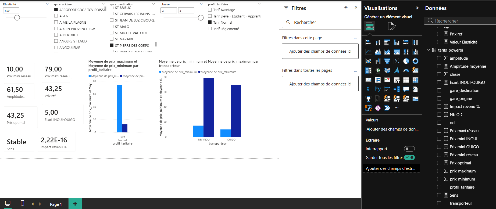

# PALIER

**Simulateur de politique tarifaire pour les trains a grande vitesse (TGV INOUI / OUIGO).**

PALIER transforme la grille de prix officielle de la SNCF en analyses de pricing concretes :
positionnement concurrentiel, exploration de la grille par profil tarifaire, et simulation
d'optimisation du revenu par elasticite-prix.

Demo en ligne : https://palier-sncf.vercel.app  ·  Donnee : SNCF Open Data (ODbL)

## Tableau de bord Power BI



Le meme moteur de calcul est disponible sous deux formes : une application web interactive
(Next.js) et ce rapport Power BI, pilote par un parametre d'elasticite (what-if) qui recalcule
en direct le prix optimal, le sens de l'ajustement et l'impact sur le revenu.

## A quoi ca sert

- **Explorer la grille** : par origine-destination, classe et profil tarifaire (Avantage,
  Reglemente, Etudiant...), la fourchette de prix reelle (min / max).
- **Comparer la concurrence** : l'ecart de prix TGV INOUI face a OUIGO, par trajet.
- **Simuler une politique de prix** : un curseur d'elasticite calcule le prix qui maximise
  le revenu et l'ecart avec le prix de reference.

## Donnee

Toutes les analyses reposent sur le jeu de donnees ouvert officiel de la SNCF
**« Tarifs TGV INOUI et OUIGO »** (plus de 36 000 tarifs : origine-destination, classe,
profil tarifaire, prix minimum et maximum).

Source : SNCF Open Data, https://ressources.data.sncf.com/explore/dataset/tarifs-tgv-inoui-ouigo/
Licence : Open Database License (ODbL).

## Methodologie et garde-fous

- **Donnee reelle** : la grille de prix et le positionnement INOUI / OUIGO.
- **Hypothese parametrable** : l'elasticite-prix. Estimer la vraie elasticite exigerait des
  donnees de demande appariees, non publiques. Le curseur permet de tester des scenarios.
- **Calculs deterministes** : tous les resultats proviennent de formules explicites, aucune
  IA generative dans les chiffres. Le prix optimal suit `p* = p_ref * (1 + e) / (2 * e)`
  (demande lineaire), il ne depend que du prix de reference et de l'elasticite.
- Modele demonstrateur, distinct du moteur de yield management de production de la SNCF.

## Stack

- **Ingestion / donnee** : Python, pandas, DuckDB (API Opendatasoft SNCF)
- **Web** : Next.js 15, React 19, TypeScript, Recharts, Tailwind CSS 4
- **BI** : Power BI (mesures DAX, parametre what-if)
- **Automatisation** : GitHub Actions (snapshot quotidien de la grille : fare tracking)
- **Deploiement** : Vercel

## Lancer en local

Pre-requis : Python 3.12+, Node.js 20+.

Ingestion et exports (a la racine) :
```bash
python -m venv .venv
# Windows : .\.venv\Scripts\Activate.ps1   |   macOS/Linux : source .venv/bin/activate
pip install -r requirements.txt
python ingest.py        # telecharge la grille officielle -> pricing.duckdb
python export_web.py    # ecrit web/src/data/tarifs.json + powerbi/tarifs_powerbi.csv
```

Application web :
```bash
cd web
npm ci --ignore-scripts   # installation exacte depuis le lockfile, sans scripts post-install
npm run dev               # http://localhost:3000
```

## Structure

palier/
├── ingest.py # ingestion de la base des prix (SNCF Open Data)
├── export_web.py # normalisation -> JSON (web) + CSV (Power BI)
├── pricing.py # moteur RM deterministe (reference Python)
├── requirements.txt
├── .github/workflows/track.yml # fare tracking quotidien
├── docs/powerbi.png # capture du rapport Power BI
├── powerbi/tarifs_powerbi.csv # export pour Power BI / Excel
└── web/ # application Next.js
└── src/
├── app/ # page, layout, styles, bloc d'explication
├── lib/pricing.ts # moteur RM (portage TypeScript)
└── data/tarifs.json # donnee normalisee lue par l'app


## Licence et attribution

Donnee : SNCF Open Data, sous licence ODbL. Ce projet est un cas d'etude personnel a but
de demonstration et n'est pas affilie a la SNCF.
